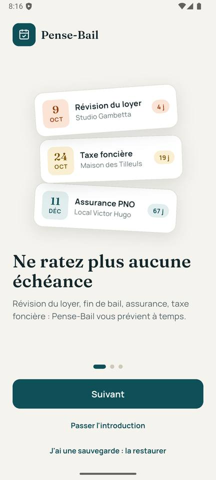
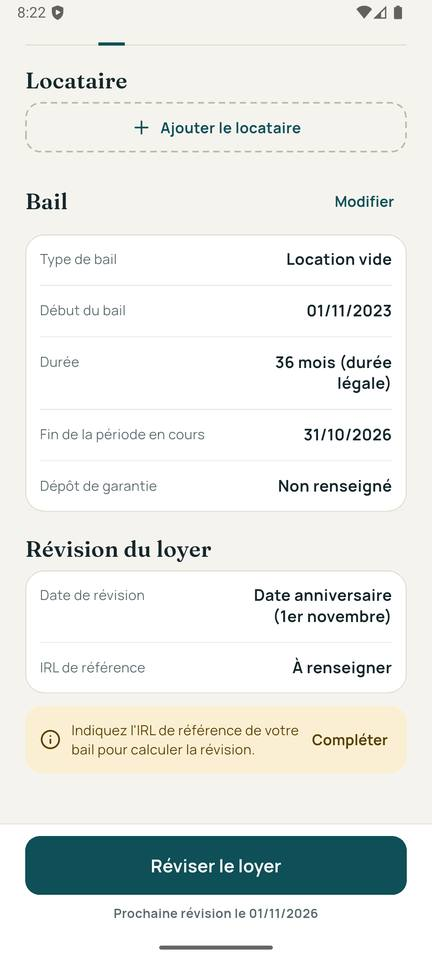
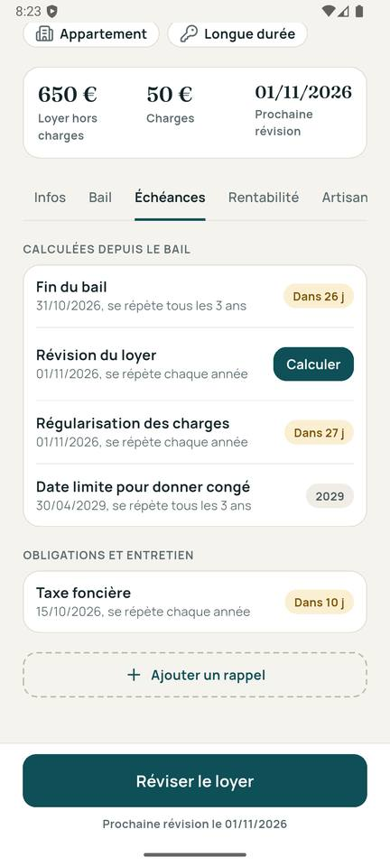
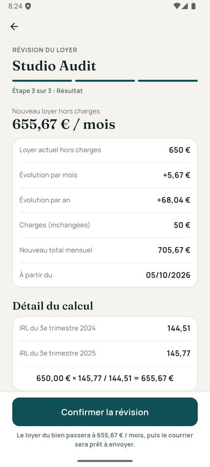
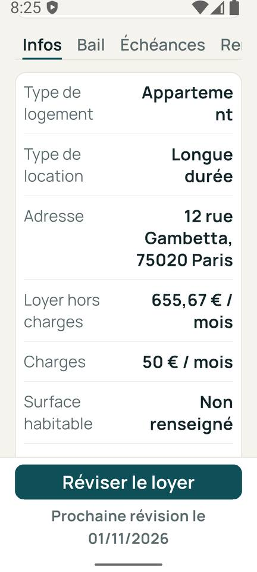
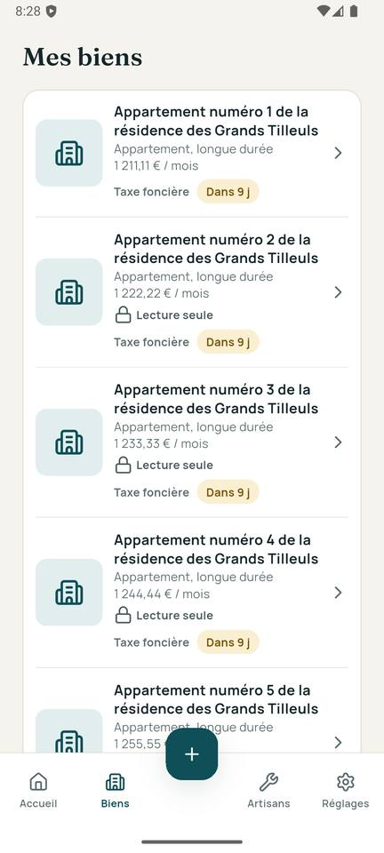
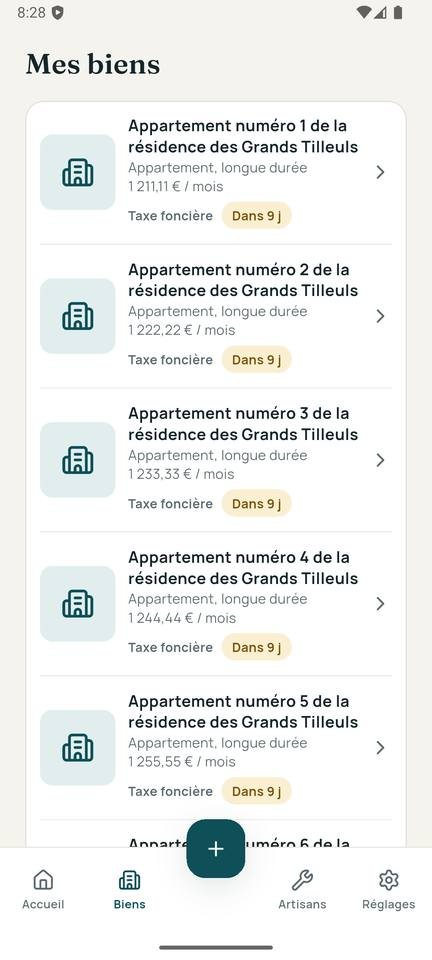

# Audit de Pense-Bail du 05/10/2026

Audit en lecture seule, sur le commit `fbcf96f` (« Version gratuite et
Premium, mode bêta »). Références : `CLAUDE.md`, `docs/cahier-des-charges.md`,
`docs/design-system.md`, `docs/conventions-code.md`, `docs/decisions.md`,
`lib/core/config/regles_legales.dart`. Aucun audit précédent dans `docs/` :
pas de comparaison.

Fichiers créés : ce rapport et le dossier de captures
`docs/audit-2026-10-05-captures/` (24 images). Rien d'autre n'a été modifié
dans le dépôt ; les deux tests temporaires utilisés pour vérifier des
hypothèses ont été supprimés (`git status` : seul `docs/Prompts/PROMPT-AUDIT.md`
est non suivi, comme avant l'audit). L'émulateur a été remis dans son état
d'origine (base vide, taille du texte 1.0, mode sombre désactivé).

## 1. Synthèse

L'application est saine sur le plan technique : analyse sans erreur,
215 tests au vert, domaine couvert à 98 %, fichiers générés à jour, schéma de
base cohérent, table IRL identique à la série de l'INSEE, aucun appel réseau
hors INSEE, aucune couleur ni taille de police en dur. Le passage gratuit /
Premium se comporte comme prévu, y compris avec 20 biens.

Les écarts les plus sérieux ne sont pas des plantages mais des risques
silencieux : des dates qui se décalent d'un jour selon le fuseau horaire du
téléphone, des règles juridiques incertaines présentées comme certaines, et
une publication encore impossible (icône Flutter, signature de debug).

| Sévérité | Nombre |
| --- | --- |
| Bloquant | 3 |
| Important | 7 |
| Mineur | 25 |

Les trois priorités :
1. **A2-03** : dates enregistrées avec le décalage horaire du téléphone ; une
   sauvegarde restaurée dans un autre fuseau (outre-mer, voyage) décale toutes
   les échéances d'un jour, dates légales comprises.
2. **A2-01 et A2-02** : les règles marquées `aVerifier` ne sont jamais
   signalées à l'écran, et le courrier affirme l'existence d'une clause de
   révision et d'un trimestre « prévu au bail » sans l'avoir demandé.
3. **A5-01 à A5-03** : publication bloquée (icône et écran de lancement
   Flutter, signature de debug, liste « Avant publication » non commencée).

## 2. Résultats des commandes

Environnement : Flutter 3.47.5 (stable), Windows 11, émulateur Android
`Medium_Phone_API_35`.

| Commande | Résultat |
| --- | --- |
| `flutter pub get` | OK. « 37 packages have newer versions incompatible with dependency constraints » |
| `flutter analyze` | `No issues found!` |
| `flutter test --coverage` | `All tests passed!` : 215 tests en 34 s |
| `dart run build_runner build` puis `git status` | 141 sorties écrites, aucun fichier modifié : générés à jour |
| `flutter pub outdated` | 5 dépendances directes en retard d'un correctif (voir A1-03) |

### Couverture (lignes, hors `.g.dart`)

Total : 5 310 / 7 413 lignes, soit **71,6 %**.

| Dossier | Couverture |
| --- | --- |
| `lib/domain/services` | 98,4 % (317 / 322) |
| `lib/domain/usecases` | 97,8 % (218 / 223) |
| `lib/domain/entities` | 85,5 % (200 / 234) |
| `lib/core` | 88,7 % |
| `lib/app` | 87,0 % |
| `lib/data` | 66,4 % (631 / 950) |
| `lib/features` | 63,8 % (2 796 / 4 381) |

Fichiers du domaine les moins couverts : `entities/revision.dart` 62,5 %,
`entities/bailleur.dart` 68 %, `entities/bail.dart` 69,7 %,
`entities/droits.dart` 71,4 %, `usecases/gestion_artisans.dart` 82,4 %,
`services/acces_biens.dart` 83,9 % (il s'agit surtout de `copyWith` et de
`toString` jamais appelés).

Fichiers à 0 % : `edition_intervention_page.dart`,
`edition_investissement_page.dart`, `edition_locataire_page.dart`,
`edition_mouvement_page.dart`, `recapitulatif_page.dart`,
`onglet_artisans.dart`, `etape_photo.dart`, `etape_recapitulatif.dart`,
`sheets_indices.dart` (saisie manuelle d'un IRL), `contact.dart`,
`tables.dart` (déclaratif). Presque nuls : `edition_bien_page.dart` 1,5 %,
`edition_artisan_page.dart` 1,5 %, `service_notifications.dart` 6,2 %,
`photo_service.dart` 8,7 %.

### Dépendances (`flutter pub outdated`)

| Paquet | Actuel | Disponible |
| --- | --- | --- |
| drift / drift_dev | 2.35.0 | 2.35.1 |
| go_router | 18.0.1 | 18.0.2 |
| url_launcher | 6.3.2 | 6.3.3 |
| flutter_timezone | 5.1.0 | 5.1.1 |
| lucide_icons_flutter | 3.1.20 | 3.1.22 |
| sqlite3 (transitif, moteur de la base) | 3.5.2 | 3.7.0 |

`flutter_local_notifications` (22.3.1), `pdf` (3.13.1) et `printing`
(5.15.1) sont à jour.

## 3. Constats

Format : identifiant, sévérité, constat, preuve, règle, correction proposée,
test à ajouter.

### Axe 1 : santé technique

**A1-01 · important · Migrations de la base jamais testées.**
Preuve : aucun test n'exécute `onUpgrade` (`lib/data/local/database.dart:42`) ;
pas de schémas exportés par `drift_dev`. Seule une sauvegarde du schéma 3 est
testée (`test/data/sauvegarde_test.dart`, test « sauvegarde du schéma 3 ») ;
les schémas 1 et 2 ne le sont pas. La migration v3 → v4 n'a été vérifiée qu'à
la main sur l'émulateur. Règle : conventions-code, « les sauvegardes JSON d'un
schéma plus ancien doivent rester restaurables ». Correction : exporter les
schémas (`dart run drift_dev make-migrations`) et ajouter les tests de
migration générés. Tests : migration v1 → v4 avec données ; restauration
d'une sauvegarde v1 et v2.

**A1-02 · mineur · Écrans de saisie non testés.**
Preuve : couverture à 0 % des formulaires locataire, mouvement,
investissement, intervention, artisan, et de la saisie manuelle d'un IRL
(section 2). Ce sont eux qui affichent les refus des droits
(`executerSiAutorise`). Règle : conventions-code, tests. Correction : un test
de widget par formulaire (enregistrement, suppression, refus en gratuit).

**A1-03 · mineur · Correctifs de dépendances disponibles.**
Preuve : tableau de la section 2. Correction : `flutter pub upgrade` puis
suite de tests ; aucune montée de version majeure nécessaire.

**A1-04 · mineur · Trois fichiers de tests tournent sur la date réelle.**
Preuve : `test/features/onboarding_controller_test.dart`,
`test/features/etape_bien_test.dart`, `test/widget_test.dart` ne surchargent
pas `aujourdhuiProvider` ; l'onboarding lit en plus `Dates.aujourdhui()`
directement (A2-08). Aucune assertion ne dépend aujourd'hui de la date, mais
les échéances créées varient selon le jour d'exécution. Correction : date
fixée partout. Aucune autre aide de test n'est nommée `*_test.dart` ; aucun
test sans assertion (les trois signalés par la recherche passent par l'aide
`refuse()` de `sauvegarde_test.dart`).

**A1-05 · mineur · Référence obsolète dans `pubspec.yaml`.**
Preuve : `pubspec.yaml:32` « Icônes au trait (UI.md §5) » ; le fichier
s'appelle `docs/design-system.md`. Correction : mettre à jour le commentaire.

### Axe 2 : règles métier

**A2-01 · important · Les règles incertaines ne sont pas signalées à
l'utilisateur.**
Preuve : aucun des champs `aVerifier` n'est lu par l'interface (`grep
aVerifier lib` ne trouve qu'un commentaire, `calculateur_bail.dart:56`) ;
`aVerifierIndiceUtilise`, `aVerifierGelDpe` et `aVerifierRegularisation` ne
sont utilisés nulle part. Seules les dates fiscales disent « Date
indicative » (`textes_echeances.dart:39-43`). Le gel F/G est présenté comme
absolu (« la loi interdit d'augmenter son loyer »,
`calculateur_revision.dart:16`, `edition_bien_page.dart:426`) alors que la
règle retenue est volontairement élargie (`regles_legales.dart:270-274`).
Règles non signalées : bail vide de 6 ans pour une personne morale, bail
étudiant de 9 mois, régularisation des charges au forfait en meublé, indice
retenu pour une révision en retard, mode de calcul du délai de congé (en
partie couvert par « bien avant cette date »), mobilité, professionnel,
commercial, amiante. Règle : CLAUDE.md, « interprétation incertaine → champ
`aVerifier` et signalement à l'utilisateur ». Correction : afficher une note
« À vérifier » là où la règle s'applique (fiche du bail, révision, échéance
concernée), et nuancer le message F/G. Test : présence de la note sur chaque
écran concerné.

**A2-02 · important · Le courrier affirme une clause et un trimestre
« prévus au bail » sans les avoir demandés.**
Preuve : `courrier_revision.dart:80` « Conformément à la clause de révision
de votre bail » et `:85` « Le trimestre de référence prévu au bail est le
3e trimestre » (capture 13), alors que le trimestre a été présélectionné par
défaut (« Nous avons présélectionné le … : vérifiez »). L'application ne
demande jamais si le bail contient une clause de révision, condition d'une
révision selon l'IRL (loi du 6 juillet 1989, art. 17-1, à vérifier sur
Légifrance). Règle : CLAUDE.md, aucune supposition sur une règle légale.
Correction : demander « Votre bail contient-il une clause de révision ? »
(sinon pas de révision) et adapter la phrase du trimestre quand il vient du
défaut légal. Test : courrier sans trimestre au bail.

**A2-03 · important · Les dates se décalent d'un jour selon le fuseau
horaire.**
Preuve : les dates sont enregistrées comme des instants avec décalage
(`build.yaml:7` `store_date_time_values_as_text: true`). Une échéance créée
au 15/10 est stockée `2026-10-15T00:00:00.000 +02:00` ; lue sur un téléphone
en UTC, elle s'affiche **14 OCT** (capture 24, base générée en France puis
ouverte sur l'émulateur). Une sauvegarde restaurée dans un autre fuseau
(outre-mer, voyage vers l'ouest) décale ainsi toutes les échéances, dates
légales comprises (fin de bail, date limite de congé). Règle : défaut
objectif (incohérence de données). Correction : enregistrer les dates
métier sans heure (texte `AAAA-MM-JJ` via un `TypeConverter`, ou minuit UTC),
migration des données et lecture des anciennes sauvegardes. Test : relire
une ligne `…+02:00` dans un fuseau à l'ouest et vérifier le même jour.

**A2-04 · important · « En retard » le jour même de l'installation.**
Preuve : bien ajouté le 05/10/2026, bail commencé en 2023 : l'onglet
Rentabilité affiche « 9 mois sans loyer indiqué comme reçu » et 9 cases
« En retard » dans la couleur d'alerte (capture 10). C'est conforme à la
décision (« mois entièrement écoulé, après le début du bail, non coché »),
mais contraire à l'intention du design system (§1 : « être rassuré, pas
stressé ») ; les cases reprennent en plus les couleurs de statut réservées
aux échéances (§2, `onglet_rentabilite.dart:391-394`). Correction proposée
(à décider) : compter les retards à partir de la date d'ajout du bien dans
l'application, et utiliser une couleur neutre. Test : bien créé aujourd'hui
→ aucun mois en retard.

**A2-05 · mineur · Cash-flow annuel faux de quelques centimes.**
Preuve : `rentabilite.dart:27` `cashFlowAnnuel => cashFlowMensuel * 12`
(mensuel arrondi). Test temporaire : loyer 650 €, taxe foncière 10 € :
7 790,04 € affichés au lieu de 7 790,00 €. Correction : calculer l'annuel
directement. Test : cet exemple.

**A2-06 · mineur · Mois de début du bail compté en retard.**
Preuve : test temporaire, bail commencé le 20/09/2026 : septembre est « en
retard » (`rentabilite.dart`, `_avantBail` ne regarde que le mois). À
décider : mois partiel dû ou non. Test : bail commencé en cours de mois.

**A2-07 · mineur · Une valeur légale hors de `regles_legales.dart`.**
Preuve : entretien annuel de la chaudière, `intervalleMois: 12` écrit dans
`onglet_echeances.dart:161`. Règle : CLAUDE.md, règles légales uniquement
dans `regles_legales.dart`. Correction : constante avec sa source.

**A2-08 · mineur · Date du jour lue hors du provider.**
Preuve : `onboarding_controller.dart:230`, `etape_bien.dart:45` et `:95`
appellent `Dates.aujourdhui()` ; `GestionEcheances.marquerFaite` date
`faiteLe` avec `DateTime.now()` (`gestion_echeances.dart:29`). Aucun service
du domaine ne lit la date (vérifié). Correction : passer
`aujourdhuiProvider`.

**A2-09 · mineur · Règles sans test.**
Preuve : aucun test sur la validité des diagnostics, sur les baux
saisonnier, professionnel et commercial, ni sur le cas « baisse de l'indice »
avec note (seul `expect(r.baisse, isFalse)`,
`calculateur_revision_test.dart:242`). Tests à ajouter : un par règle.

**A2-10 · mineur · Sources manquantes dans `regles_legales.dart`.**
Preuve : dates fiscales, `jourPublicationIrl`,
`periodiciteRegularisationChargesMois` et gel F/G (article précis) sans
référence. Règle : CLAUDE.md, « avec la source ».

Vérifié et conforme : montants uniquement en `int` (aucun `double` de
montant ; `rendementBrut` est un ratio), affichage via `Formats` (seule
conversion hors `Formats` : `ChampMontant.texte`, pour pré-remplir un champ),
centimes toujours présents dans le courrier et le récapitulatif
(`montantComplet`), aucune valeur d'IRL écrite en dur, table embarquée
identique à la série INSEE (95 valeurs sur 95, dernière T2 2026 = 148,37),
une saisie manuelle ne remplace jamais une valeur INSEE
(`drift_repositories.dart:469`, tests `indices_irl_test.dart:156` et
`database_test.dart:147`), calcul de révision juste (capture 12 :
650 € × 145,77 / 144,51 = 655,67 €), fins de mois et 29 février
(`dates_test.dart`), loyer du mois selon les révisions (révision le 1er :
compte ce mois-ci ; en cours de mois : à partir du suivant).

### Axe 3 : gratuit / Premium

Les huit règles du prompt sont respectées : voir le tableau de conformité
(section 4) et les captures 19 à 23 (20 biens : Premium, fin d'abonnement,
19 biens en lecture seule, retour en Premium, build sans bêta).

**A3-01 · mineur · Trois lectures directes du statut.**
Preuve : `accueil_page.dart:199` (badge bêta), `premium_page.dart:29`
(écran Premium), `reglages_page.dart:202` (interrupteur bêta) lisent
`estPremium`. Ce sont les seuls endroits où le statut est lui-même affiché ;
partout ailleurs les écrans demandent la fonctionnalité. Correction :
documenter l'exception dans les conventions.

**A3-02 · mineur · L'introduction promet une fonction Premium.**
Preuve : `etape_bienvenue.dart:32` « Vos courriers prêts en un clic »
(capture 02) ; dans l'application publiée (gratuite), le courrier est
réservé à Premium. Correction : formulation compatible avec les deux
versions.

**A3-03 · mineur · « L'alerte DPE » n'existe pas en tant que telle.**
Preuve : texte de l'écran Premium et du message de fin (« l'alerte DPE »)
alors que l'application bloque la révision et affiche une note, sans alerte
dédiée. Correction : « le blocage de la révision des logements F et G » ou
créer l'alerte.

Contournements recherchés : aucun écran n'écrit un bien, un bail, un
locataire, une échéance, la rentabilité ou les artisans sans passer par un
cas d'usage contrôlé. Exceptions voulues et documentées : onboarding
(`FinaliserOnboarding`) et restauration d'une sauvegarde. Le statut simulé
est exclu de la sauvegarde (tests `sauvegarde_test.dart`, groupe « mode
Premium simulé »). Sans `--dart-define=BETA=true` : ni section bêta ni badge,
application en gratuit même si le réglage simulé vaut « premium »
(captures 22 et 23).

### Axe 4 : interface, rédaction, accessibilité

Recherches systématiques dans `lib/features/` et `lib/core/widgets/` :
aucune occurrence de `Color(`, `Colors.`, `TextStyle(`, `fontSize`,
`showModalBottomSheet` (hors `feuille.dart`), marge ou rayon numérique,
tiret cadratin, bouton « OK » ou « Valider » seul, tutoiement. Tous les
`IconButton` ont un `tooltip`. Typographie française correcte (espaces avant
« : ? ! »). Mode sombre : l'application reste claire et lisible
(capture 16), conforme au design system (§10).

**A4-01 · important · Lignes cliquables non regroupées pour les lecteurs
d'écran.**
Preuve : sans `Semantics(container: true, …)` : `cartes_biens.dart`
(carte de bien de l'accueil), `biens_page.dart` (`_LigneBien`),
`artisans_page.dart` (`_LigneArtisan`), `onglet_bail.dart`
(`_LigneLocataire`), `onglet_rentabilite.dart` (`_LigneMouvement`),
`onglet_artisans.dart` (`_LigneIntervention`). Règle : conventions-code,
« chaque ligne d'information est un seul élément pour les lecteurs
d'écran ». Correction : même schéma que `LigneEcheance` (libellé complet,
boutons appeler / écrire laissés accessibles). Test : `bySemanticsLabel`
pour chaque ligne.

**A4-02 · important · Mots coupés en grande taille de texte.**
Preuve : texte système à 200 %, onglet Infos : « Apparteme / nt »
(capture 15) ; `LigneInfo` partage la largeur en deux `Expanded` égaux
(`composants.dart:363-367`). Règle : design-system §3 (« sans casser la mise
en page ») et public cible. Correction : libellé au-dessus de la valeur
au-delà d'une certaine taille de texte, ou largeur proportionnelle. Test :
`textScaler` 2.0 sur la fiche.

**A4-03 · mineur · Dimensions locales au lieu des tokens.**
Preuve : `etape_nombre_biens.dart:15` (120), `choix_cartes.dart:33,109,110`
(320, 64, 2), `composants.dart:223-224` (24, 3 : doublon de
`AppSizes.soulignementOnglet`), `composants.dart:475-476` (6, 4),
`carte_synthese.dart:14` (0,85), opacité « indisponible » à 0,5
(`choix_bien_revision.dart:24`) et 0,55 (`composants.dart:79`). Règle :
CLAUDE.md, tokens. Correction : déplacer dans `AppSizes` et unifier
l'opacité.

**A4-04 · mineur · Date longue dans le détail d'une échéance.**
Preuve : `detail_echeance.dart:107` affiche « 14 octobre 2026 ». Règle :
design-system §8 (JJ/MM/AAAA). Le nom du mois est en outre obtenu par
découpage de cette date (`onglet_bail.dart:206`,
`onglet_rentabilite.dart:403`) : fragile. Correction : `Formats.date` et une
fonction dédiée au nom du mois.

**A4-05 · mineur · Onglets de la fiche coupés.**
Preuve : « Artisan » coupé au bord, sans indice de défilement (captures 07
et 15). Correction : onglets plus courts ou indicateur de défilement.

**A4-06 · mineur · Titre coupé au trait d'union.**
Preuve : « Combien de biens louez- / vous ? » (capture 03). Correction :
trait d'union insécable (U+2011).

**A4-07 · mineur · Clavier et bouton « Continuer ».**
Preuve : sur le dernier champ, le clavier propose « suivant » et masque
« Continuer » (capture 04). Correction : `TextInputAction.done` sur le
dernier champ.

**A4-08 · mineur · Puce de filtre trop large.**
Preuve : un nom de bien long donne une puce plus large que l'écran
(capture 17) ; `PuceFiltre` (`listes.dart:202`) ne limite pas la largeur.
Correction : largeur maximale et points de suspension.

**A4-09 · mineur · Bannière d'information hors de son usage.**
Preuve : `panneau_notifications.dart:74` utilise la bannière jaune pour
« Les rappels sont désactivés » (capture 06) ; design-system §6 la réserve
aux données manquantes. À décider : élargir la règle ou changer de
composant.

**A4-10 · mineur · Casse incohérente.**
Preuve : « Appartement, Longue durée » au récapitulatif de l'onboarding
(capture 05) contre « appartement, longue durée » dans la liste des biens.

**A4-11 · mineur · Barre d'action fixe envahissante en grand texte.**
Preuve : à 200 %, « Réviser le loyer » et sa légende occupent environ un
cinquième de l'écran (capture 15). Correction : plafonner l'échelle du texte
de la barre comme celle de la navigation.

Parcours vérifiés sur l'émulateur : introduction (captures 01-02),
identité, nombre de biens (03), deux biens (04), récapitulatif (05),
accueil, refus des notifications (06), fiche et chaque onglet (07-11),
révision et courrier (12-13), réglages, texte à 200 % (14-15), mode sombre
(16), 20 biens aux noms et adresses très longs (17-18), gratuit et Premium
(19-23). Les noms longs passent à la ligne sans débordement.

### Axe 5 : architecture, données, publication

Vérifié et conforme : aucun import de Flutter ni de drift dans
`lib/domain/` ; aucun écran n'utilise drift ; seul appel réseau : la série
IRL de l'INSEE (`service_indices_irl.dart:73`), `url_launcher` ne sert qu'à
`tel:` et `mailto:` ; permissions Android (fusionnées) : `INTERNET`,
`POST_NOTIFICATIONS`, `RECEIVE_BOOT_COMPLETED`, `VIBRATE`, toutes justifiées ;
textes iOS de l'appareil photo et de la galerie en français ;
notifications : 60 au plus (`ConfigApp.maxRappelsProgrammes`, test
« limite iOS »), mode inexact (`service_notifications.dart:203`),
reprogrammation au redémarrage (récepteur `ScheduledNotificationBootReceiver`
déclaré), refus géré (capture 06) ; robustesse : INSEE indisponible (tests),
sauvegarde illisible ou plus récente refusée (tests), photo absente
remplacée par l'illustration (`photo_bien.dart:41`).

**A5-01 · bloquant · Icône et écran de lancement Flutter par défaut.**
Preuve : `android/app/src/main/res/mipmap-*/ic_launcher.png` est le logo
Flutter ; l'écran de lancement affiche aussi ce logo. Absent de la liste
« Avant publication ». Correction : icône et écran de lancement Pense-Bail
(Android et iOS), puis ajout à la liste.

**A5-02 · bloquant · Version publiée signée avec la clé de debug.**
Preuve : `android/app/build.gradle.kts:31-34` `signingConfig =
signingConfigs.getByName("debug")` (et le commentaire « TODO » ligne 20).
Absent de la liste « Avant publication ». Correction : clé de publication
hors du dépôt, configuration de signature `release`.

**A5-03 · bloquant · Liste « Avant publication » non commencée.**
Preuve : `ReglesLegales.derniereVerification = null`
(`regles_legales.dart:110`) ; `ConfigApp.editeur` et `contactEditeur` à
`null` (la section « Éditeur » des mentions légales n'apparaît donc pas) ;
iOS jamais testé ; RevenueCat non branché. La table IRL embarquée (T2 2026)
est à jour à ce jour ; le T3 2026 paraîtra mi-octobre. Correction : traiter
la liste avant publication.

**A5-04 · mineur · iOS en anglais par défaut.**
Preuve : `ios/Runner/Info.plist` `CFBundleDevelopmentRegion` =
`$(DEVELOPMENT_LANGUAGE)`, pas de `CFBundleLocalizations` avec `fr`.
Correction : région `fr`.

**A5-05 · mineur · Journal pouvant contenir des données personnelles.**
Preuve : `onboarding_controller.dart:66` `debugPrint('Brouillon
d'onboarding illisible, ignoré : $e')` : une `FormatException` peut citer un
extrait du brouillon (nom, adresse). `debugPrint` n'est pas retiré en
version publiée. Correction : message sans l'exception.

**A5-06 · mineur · Écritures hors cas d'usage ou sans transaction.**
Preuve : profil (`edition_profil_page.dart:74`) et réglages de l'accueil
écrits directement par le repository ; `GestionFinances`,
`GestionArtisans` et les locataires de `GestionBiens` vérifient puis
écrivent sans `transactions.executer` (écritures simples, contrôle et
écriture non atomiques). Règle : conventions-code (écritures dans des cas
d'usage, dans `transactions.executer`). Correction : cas d'usage du profil,
transactions partout.

## 4. Conformité de `decisions.md`

| Décision | Respectée | Preuve |
| --- | --- | --- |
| 4 statuts d'échéance (≤ 7 j, 8-30, 31-90, au-delà) | Oui | `proximite.dart`, `proximite_test.dart` |
| Barre à 5 emplacements, « + » central, onglet Réglages, nom Pense-Bail | Oui | `shell.dart`, captures |
| Montants : centimes si non nuls ; courriers toujours | Oui | `Formats.montant` / `montantComplet`, capture 13 |
| Polices Fraunces et Manrope embarquées | Oui | `pubspec.yaml:66-77` |
| Cloche sans cercle, pastille des urgentes | Oui | `panneau_notifications.dart:33-37`, capture 17 |
| Téléphone et email du bailleur facultatifs | Oui | formulaire d'identité |
| Complément d'adresse facultatif, avant la voie dans les courriers | Oui | `adresse_test.dart`, `courrier_revision_test.dart:85` |
| Rappels J-30, J-7, J-1, 9 h, sans alarmes exactes | Oui | `ConfigApp`, `service_notifications.dart:203` |
| Type désactivé affiché sans notification | Oui | `planification_rappels_test.dart:102` |
| « Appliquer à toutes » remplace les rappels | Oui | `preferences_rappels_test.dart:86` |
| Recalcul des échéances seulement si type, bail, dates ou durée changent | Oui | `gestion_biens.dart`, `gestion_biens_test.dart` |
| Rendement brut et net | Oui | `rentabilite.dart` |
| Cash-flow = loyer − crédit − charges | Partiellement | formule juste, annuel arrondi (A2-05) |
| Bilan : mois cochés × loyer en vigueur ; révision en cours de mois au mois suivant | Oui | `loyerDuMois`, test temporaire |
| Mois « en retard » | Oui (à revoir) | conforme, mais A2-04 et A2-06 |
| Journal sans « Loyer » ni « Intervention » | Oui | `edition_mouvement_page.dart:18-27` |
| Indices : table embarquée, INSEE ≤ 1 fois / semaine, saisie manuelle, INSEE jamais remplacée | Oui | `service_indices_irl.dart:63`, `drift_repositories.dart:469`, tests |
| Ancien indice : même trimestre, année précédente | Oui | `calculateur_revision_test.dart:172` |
| Révision en retard (< 1 an) : effet à la date du courrier | Oui | capture 13, `courrier_revision_test.dart:79` |
| Date de révision considérée comme faite (3 cas) | Oui | `calculateur_revision_test.dart:83-124` |
| Trimestre par défaut : dernier publié à la signature | Oui | `calculateur_revision_test.dart:161` |
| Baisse de l'indice : révision possible avec une note | Oui, non testé | `revision_page.dart:705` (A2-09) |
| Courrier : article 17-1 (meublé 25-9 et 17-1), « Au locataire » | Oui | `regles_legales.dart`, `courrier_revision.dart:71`, mais A2-02 |
| Sauvegarde JSON vérifiée avant restauration | Oui | `sauvegarde_test.dart` |
| Gratuit : un bien actif ; Premium : le reste | Oui | `droits.dart`, captures 19-21 |
| Écrans : « disponible ? » jamais « payé ? » ; source unique | Partiellement | 3 lectures du statut affiché (A3-01) |
| Écritures contrôlées par `VerrouBiens` | Oui | cas d'usage, `fonctionnalites_premium_test.dart` |
| Bien actif : le plus ancien (`creeLe`, `ordre`, `id`), relais après suppression | Oui | `acces_biens_test.dart` |
| Perte du Premium : rien supprimé ; lecture seule ; échéances faites / reportées | Oui | captures 19-21, `gestion_echeances_test.dart` |
| Révision sur bien verrouillé : calcul visible, confirmation refusée | Oui | `reviser_loyer_test.dart` |
| Rentabilité et artisans déjà saisis consultables | Oui | `version_gratuite_test.dart` |
| `courrierInclus` | Oui | `reviser_loyer_test.dart`, `sauvegarde_test.dart` |
| Ajout au-delà de la limite refusé ; « + » vers Premium ; note d'onboarding | Oui | `gestion_biens_test.dart`, `version_gratuite_test.dart` |
| Écran Premium | Oui | capture de la phase 3, `premium_page.dart` |
| Message de fin d'abonnement unique | Oui | capture 19, `version_gratuite_test.dart` |
| Bêta : section, badge, Premium par défaut ; absent sans le drapeau | Oui | captures 22-23, `reglages_test.dart` |
| Réglages propres au téléphone hors sauvegarde | Oui | `sauvegarde_test.dart` |
| Biens vendus ou retirés | Non (prévu) | étape suivante, non commencée |

## 5. À vérifier manuellement

- **Lecteur d'écran (TalkBack)** : l'outil d'inspection ne voit aucun
  libellé sur les champs de saisie (`NAF="true"`) ; Flutter les expose
  normalement comme indication. À confirmer à l'oreille, avec les lignes
  de A4-01.
- **Fin d'un bail commencé un 29 février** : l'application calcule le
  27/02 (veille du 28/02 retenu comme anniversaire) ; une autre lecture
  donne le 28/02. Sens prudent, à trancher sur les sources.
- **Deux révisions rapprochées** : révision 2025 demandée en retard (effet
  le 05/10/2026), puis révision 2026 au 01/11/2026, quatre semaines plus
  tard (capture 09). Conforme aux décisions ; à confirmer juridiquement.
- **Logements G** : depuis 2025, ils ne peuvent plus faire l'objet d'un
  nouveau bail (critère de décence, calendrier à vérifier) ; l'application
  ne le signale pas. Hors périmètre actuel, à décider.
- **Notifications réelles** : réception à 9 h et après redémarrage du
  téléphone non testées (autorisation refusée pendant l'audit).
- **Message « Annuler » persistant** : en phase 6, le message « … est
  faite. Annuler » est resté affiché plusieurs secondes en suivant les
  changements d'onglet (comportement de Flutter pour un message avec
  action). Durée à fixer si gênant.
- **Accueil sans aucun bien** (après suppression du dernier) : état non
  vérifié.
- **iOS et Android à navigation à 3 boutons** : jamais testés.
- **Dialogues système en anglais** : dus à la langue de l'émulateur ; à
  revoir sur un téléphone en français.

## 6. Lots de correction proposés

Dans l'ordre où je les ferais :

1. **Dates sans fuseau horaire** (A2-03) : format de stockage, migration,
   lecture des anciennes sauvegardes, tests. C'est le seul défaut qui peut
   fausser une date légale sans que personne ne s'en aperçoive.
2. **Juridique visible** (A2-01, A2-02, A2-07, A2-10) : notes « À vérifier »
   à l'écran, question sur la clause de révision, phrases du courrier,
   sources manquantes. Ensuite seulement : vérification des règles sur les
   sources officielles (liste « Avant publication »).
3. **Accessibilité et grand texte** (A4-01, A4-02, A4-05, A4-08, A4-11),
   avec tests `bySemanticsLabel` et `textScaler`.
4. **Rentabilité** (A2-04 à décider, A2-05, A2-06).
5. **Tests manquants** (A1-01 migrations, A1-02 formulaires, A2-09 règles,
   A1-04 et A2-08 date fixée).
6. **Publication** (A5-01 à A5-04) : icône, écran de lancement, signature,
   éditeur, région iOS.
7. **Finitions** (A1-03, A1-05, A3-01 à A3-03, A4-03, A4-04, A4-06,
   A4-07, A4-09, A4-10, A5-05, A5-06).

## Annexe : captures

Dossier `docs/audit-2026-10-05-captures/` :

| N° | Contenu |
| --- | --- |
| 01-02 | Introduction ; promesse du courrier (A3-02) |
| 03 | Nombre de biens, titre coupé (A4-06) |
| 04 | Clavier ouvert, « Continuer » masqué (A4-07) |
| 05 | Récapitulatif de l'onboarding (A4-10) |
| 06 | Notifications refusées (A4-09) |
| 07-11 | Fiche : Infos, Bail, Échéances, Rentabilité (A2-04), Artisans |
| 12-13 | Résultat de la révision ; courrier (A2-02) |
| 14-15 | Texte à 200 % : accueil ; fiche, mot coupé (A4-02, A4-11) |
| 16 | Téléphone en mode sombre |
| 17-18 | 20 biens aux noms longs : accueil (A4-08) ; fiche |
| 19-21 | Fin d'abonnement avec 20 biens ; gratuit ; retour en Premium |
| 22-23 | Build sans bêta : accueil, réglages |
| 24 | Échéance du 15/10 affichée « 14 OCT » (A2-03) |

